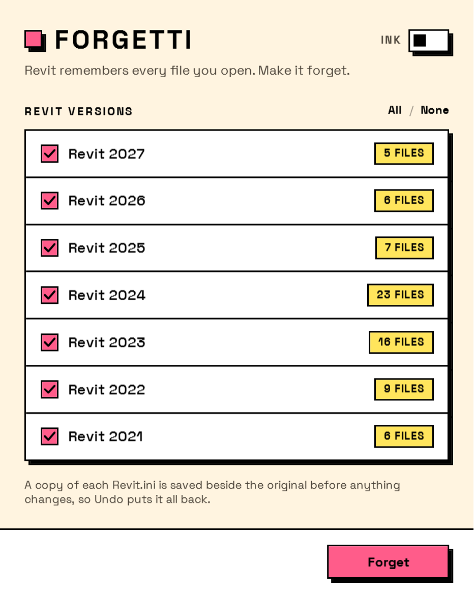
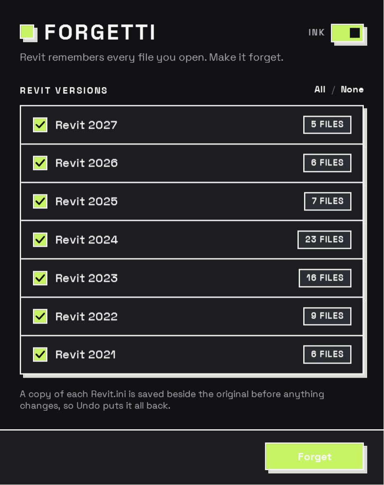
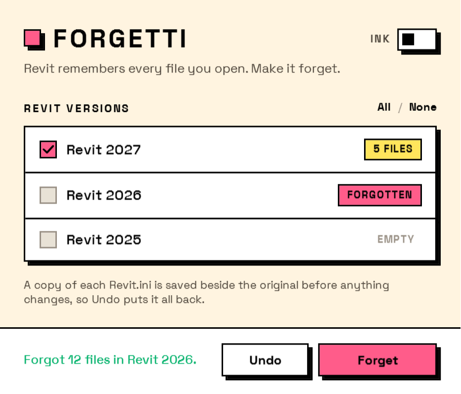
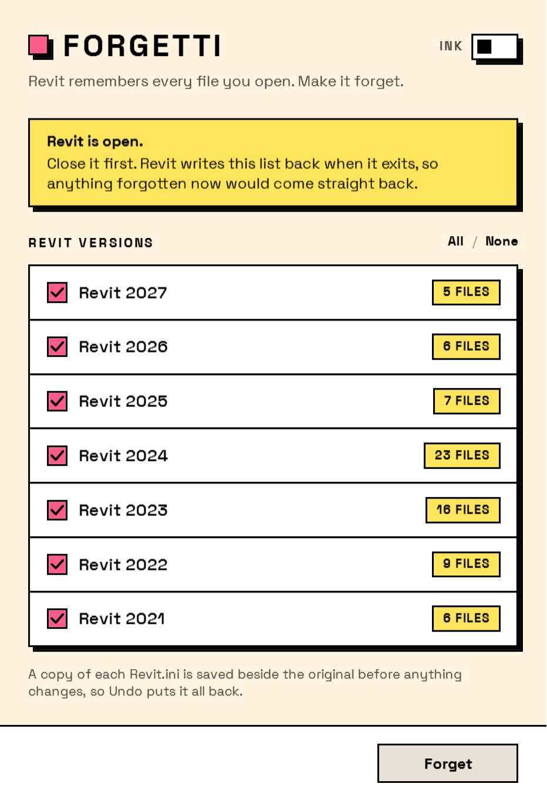

# Forgetti

**Revit remembers every file you open. Make it forget.**

[](https://github.com/johnpierson/Forgetti/actions/workflows/build.yml)
[](https://github.com/johnpierson/Forgetti/releases/latest)
[](LICENSE)
[](#download)

Forgetti clears the recent-file list in Revit. Tick the versions, press **Forget**, done.
A copy of each `Revit.ini` is saved before anything changes, and **Undo** puts it back.

<p align="center">
  
  &nbsp;
  
</p>

## Download

Grab `Forgetti.exe` from the [latest release](https://github.com/johnpierson/Forgetti/releases/latest)
and run it. There is nothing to install and nothing left behind: it is one file, it needs only
.NET Framework 4.8 (already on every Windows 10 and 11 machine), and it never asks for admin.

The file is not code-signed, so Windows SmartScreen may ask once. Choose *More info*, then
*Run anyway*.

## Why

Revit's Home page and File menu list every model you have opened recently. Before a demo, a
screen-share, a class or a hand-over, that list is either noise or a leak, and Revit offers no
way to clear it. Forgetti does, for every version on the machine at once.

## Use

1. **Close Revit.** It writes the list back when it exits, so anything forgotten while it is
   open would come straight back. Forgetti notices Revit running and waits.
2. **Run Forgetti.** Every Revit version with a settings file is listed, newest first, with how
   many recent files it holds.
3. **Untick anything you want to keep, then press Forget.**

Changed your mind? **Undo** restores every list from the copies Forgetti took.

<p align="center">
  
  &nbsp;
  
</p>

## What it touches

Exactly one thing: the `File1=`, `File2=`, ... entries under `[Recent File List]` in

```
%AppData%\Autodesk\Revit\Autodesk Revit 20xx\Revit.ini
```

The section header stays. Every other section is untouched. The file keeps its original
encoding (Revit writes UTF-16 LE with a byte-order mark) and its line endings. Before writing,
the original is copied to `Revit.ini.forgetti-bak` in the same folder, and that copy is what
**Undo** restores.

Nothing is read from or written to the registry, the cloud, or anywhere outside that folder.

## Build from source

You need the .NET SDK and the .NET Framework 4.8 targeting pack, both of which come with
Visual Studio 2022.

```bash
dotnet build Forgetti.slnx -c Release
```

```bash
dotnet test Forgetti.slnx -c Release
```

The result is `src/Forgetti/bin/Release/net48/Forgetti.exe`. It targets .NET Framework 4.8 on
purpose: a .NET 8 build would need a runtime installed on every machine it is sent to, or a
70 MB self-contained bundle, to delete a dozen lines from an .ini file.

### Development switches

| Switch | Effect |
| --- | --- |
| `--dark` | Start in the ink palette. |
| `--revit-running` | Show the "Revit is open" banner without launching Revit. |
| `--sample` | Show one made-up row in each state. Touches no files. |
| `--screenshot <path>` | Render the window to a PNG at 2x and exit. |

The images on this page were made with `--screenshot`, and CI renders one on every build to
prove the window still opens on a machine that is not the author's.

### Releasing

Push a tag and the release workflow does the rest: tests, builds with the tag as the version,
checks that the binary agrees, and publishes `Forgetti.exe` and a zip to GitHub Releases.

```bash
git tag v1.0.0 && git push origin v1.0.0
```

## The look

Forgetti wears [Interlude](https://github.com/johnpierson/Interlude)'s neubrutalist theme:
heavy black outlines, square corners, solid unblurred shadows, one loud accent, and Space Grotesk
set hard. Press a button and it drops onto its own shadow. The palette values are Interlude's
exactly, so the two sit side by side without a seam. The switch in the corner flips between
paper and ink.

## Licence

Forgetti is released under the [BSD 3-Clause License](LICENSE). Space Grotesk is embedded under
the [SIL Open Font License 1.1](src/Forgetti/Fonts/SpaceGrotesk-OFL.txt).
